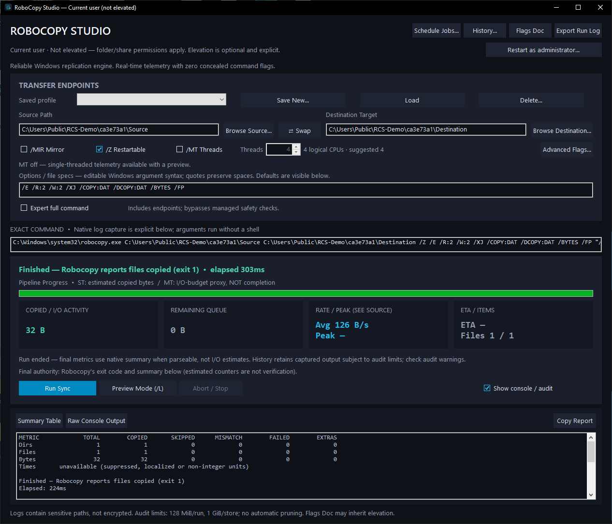
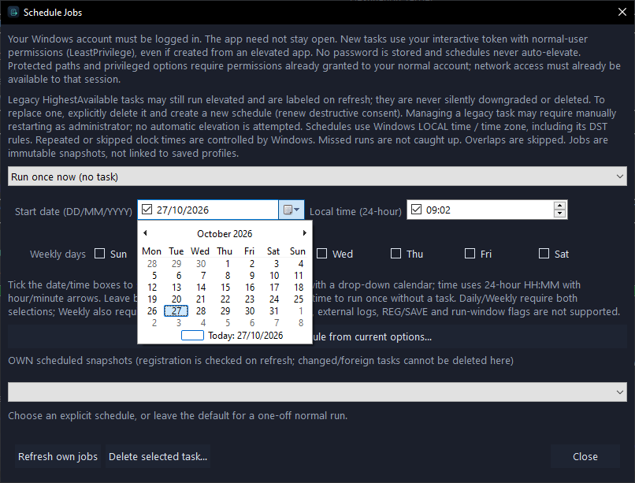

# RoboCopy Studio

A standalone, native Windows x64 GUI for Windows' built-in Robocopy engine. Built with Go and Walk/Win32: no installed Go, .NET, Python, Electron, WebView or separate GUI runtime is required to run the EXE.

**Runs as the current user by default. Administrator rights are optional, not a launch requirement.** The embedded manifest uses `asInvoker`; starting from an already-elevated process inherits its privileges. The title bar and permissions row show the actual process context.



## Features

- Side-by-side source/destination selectors, Browse and Swap, and an exact command preview.
- Editable Robocopy switches plus an Advanced Flags catalog with validation and engine-version notes.
- Preview (`/L`), normal copy, opt-in mirroring, cancellation and explicit destructive-operation confirmations.
- Estimated single-thread progress, remaining bytes, rate and ETA; clearly labeled aggregate process-I/O activity for `/MT` rather than invented per-file completion.
- Opt-in `/MT` worker selector, integer 1–128, with explicit raw-option override/adoption behavior.
- Collapsible native summary/raw console, bounded clipboard reports and streaming log export.
- Per-user profiles and run history. Loading a profile never executes it or retains deletion approval.
- One-off, future one-time, daily and selected-weekday schedules through Windows Task Scheduler.
- Day-first `DD/MM/YYYY` date selection with a mini calendar, and a native 24-hour `HH:MM` hour/minute picker.
- Dark native interface and owned warning dialogs, embedded multi-resolution icon and native caption controls.

## Download / run

Extract `RoboCopyStudio-win64.zip` and launch `RoboCopyGUI.exe` from a trusted local folder. Only the EXE is required to run; the README, artwork and screenshots are supplementary. It is an AMD64 Windows GUI executable, not an installer.

The EXE is currently **unsigned**. SmartScreen, application-control software or company policy may warn or block it independently of elevation. Verify the supplied checksum and obtain organizational approval where required. Native validation was performed on Windows 10 Pro build 18363; other Windows builds, locales, DPI settings and enterprise policies need their own acceptance checks.

### Permissions and optional elevation

Normal copying needs permission to read the source and create/update the destination. Use your ordinary Windows account for day-to-day work. Administrator membership is not required for accessible folders/shares.

- The title/permissions row explicitly distinguishes **Current user (not elevated)** from **Administrator (elevated)**.
- Backup/security switches such as `/B`, `/ZB`, `/COPYALL`, `/SEC`, `/SECFIX` or owner/audit/security copy flags may need additional rights. The UI advises you; it does not silently rewrite flags, elevate, or retry a failed copy with greater privileges. Delegated rights may suffice without administrator membership.
- **Restart as administrator…** is an explicit, default-No action. Windows owns the UAC consent/credential prompt; the app never collects or stores administrator credentials. Cancelling consent or a failed launch leaves the existing window open.
- Finish any active copy/preview/export and save a profile first. A successful restart opens a **blank form**: endpoints, commands, preview approval and jobs are not automatically replayed. The existing window closes after Windows accepts the launch.
- Supplying another administrator's credentials changes the account running the app. Profiles, history, DPAPI snapshots, schedules, mapped drives and network access may consequently differ. Elevation does not bypass share permissions; prefer explicit UNC paths where appropriate.
- The restart button is disabled when already elevated or during copy/preview. Launching normally from Explorer is the way to return to normal permissions.

## Quick start

1. Browse or enter separate absolute source and destination folders. Avoid aliases of the same tree. Managed mode rejects equal/nested paths, device/relative/alternate-stream endpoints and known local aliases.
2. Review the switches. Defaults are `/E /R:2 /W:2 /XJ /COPY:DAT /DCOPY:DAT /BYTES /FP`, with `/Z Restartable` on, `/MIR Mirror` off and `/MT Threads` off. Destination extras are not deleted by default.
3. Use **Preview Mode (/L)** to inspect the native result. Preview is not a general side-effect sandbox: selected logs, `/REG` and `/SAVE` can still write and require confirmation.
4. Choose **Run Sync**. Managed destructive options require a successful preview of the exact endpoints/options and a separate default-No confirmation. Input changes or loading a profile invalidate approval. Files can change between preview and copy.
5. Review **Summary Table**, **Raw Console Output** and **History…**. **Abort / Stop** cancels the native process, but partial files may remain and blocking network/filesystem calls can delay cancellation.

Raw switches use Windows quoting, not shell syntax. Quoted spaces and Unicode are preserved; malformed quoting, NUL/newlines and invalid Unicode are rejected. The engine is resolved from Windows System32 and executed with an argument vector, never a command shell. Catalog entries do not guarantee that the installed Windows/Robocopy version supports a switch; unsupported options remain visible and the engine's actual error is reported.

### Threads, estimates and authoritative results

The worker selector suggests `min(8, max(1, logical CPU count))`, not a CPU-count cap. Raw/Advanced `/MT` explicitly overrides the selector; **Use thread selector** adopts it. MT is opt-in because native output interleaves files.

Single-thread progress/rates/ETA require an approved, bounded preview and usable native byte/full-path/progress output. They are estimates, not content verification. MT cards show **process I/O activity**, which includes logs, metadata and retries; remaining/ETA stay unknown. Its budget proxy is capped below completion. Native final counters replace estimates when parseable; localized/suppressed/ambiguous summaries remain unavailable rather than fabricated.

Robocopy exits 0–7 are nonfatal outcomes with different meanings; 4–7 merit review. Exits 8+ are failures. Cancellation, capture failure and audit-storage failure are never presented as successful copies. The app does not cryptographically verify production copies, create versioned backups, or provide rollback.

## Scheduling

Open **Schedule Jobs…**. The default is **Run once now (no task)** with both date/time boxes unticked. Submitting it runs the existing copy action once and creates no scheduled task. An empty One time selection behaves the same. Partial selections are rejected.

- **One time (future):** choose a future date and time.
- **Daily:** choose a start date and local time.
- **Weekly:** choose a start date, time and at least one weekday.
- Tick the date box and use the arrow to open the calendar. Dates display as **DD/MM/YYYY**. Tick the time box and select/type hours/minutes or use the up/down arrows. Untick to clear. Selected midnight is valid `00:00`, not an empty time.
- Dates remain ISO `YYYY-MM-DD` internally for compatibility. Initial ambiguous/nonexistent DST times are rejected; Windows controls later recurrence/DST behavior. Missed runs are not caught up.



**New schedules use `InteractiveToken` and `LeastPrivilege`, including when created from an elevated app.** The same Windows account must be logged in, but the app itself may be closed. Keep the EXE at its registered path. No password is stored, no UAC prompt is automated and there is no logged-out/service mode. Network credentials/access must already exist in that session. Company policy can restrict task creation or execution.

Legacy `HighestAvailable` tasks from older builds retain their original privilege level and are labeled on refresh. They are not silently downgraded, rewritten or deleted. Managing one may require an explicit administrator restart. To migrate it, deliberately delete the selected verified task and create a new schedule; destructive recurring consent must be renewed. Existing tasks under another account do not become the current user's tasks.

Jobs are immutable endpoint/option snapshots, separate from profiles, protected with current-user DPAPI beneath `%LOCALAPPDATA%\RoboCopyStudioScheduled`. Editing the current form does not edit a schedule. Destructive schedules require exact-preview approval plus separate recurring authorization. Each run revalidates endpoints and performs an audited, bounded preflight before copying. Native exits below 8 map to scheduler success 0; overlap, audit/preflight/copy failure are nonzero. Scheduled workers share an overlap lock; manual copies are outside that lock.

**Refresh own jobs** checks the exact owner, executable, arguments and permitted privilege level. **Delete selected task…** removes only a verified owned task and its snapshot, not copied data or run history; it does not stop a running copy. Expert/JOB/opaque endpoints, monitoring, external logs, REG/SAVE and native run-window options are not supported for managed scheduling.

## Profiles, logs and safety boundaries

Profiles/history live under `%LOCALAPPDATA%\RoboCopyStudio`. Current-user/SYSTEM/administrators DACLs, managed identifiers, alias/hardlink checks and atomic writes protect the store, but do not isolate hostile same-account processes or administrators. Jobs use DPAPI; ordinary profiles, logs and manifests are **not encrypted** and can include sensitive paths, filenames and arguments. Do not put credentials in raw switches.

Console display is bounded to roughly 60 KB; clipboard report to 1 MiB; in-app history preview to 512 KiB; transcript capture to 128 MiB/run and store usage to 1 GiB. Preview, failure-evidence and history enumeration also have explicit limits. Limits/I/O failures are surfaced; evidence is not silently pruned. **Export Run Log** streams the captured report; **Open full log** opens its on-disk file. Clipboard history/sync can retain copied reports.

Managed path checks are guardrails, not immutable filesystem snapshots or a complete defense against concurrent junction replacement and remote/share aliases. Do not perform destructive work on hostile writable trees. `/MIR`/`/PURGE` delete destination extras; `/MOV`/`/MOVE` delete source data; `/M` changes source archive bits.

**Expert full command** permits JOB/unknown engine arguments only with explicit warnings. Its raw field contains the full argument list including endpoints. Managed endpoint/preview/telemetry guarantees do not apply. JOB files can hide endpoints, deletion and persistent side effects. Untrusted JOB files are not sandboxed; expert JOB preview is refused.

See [SECURITY.md](SECURITY.md) for scope and responsible reporting. This is not a claim of a completed comprehensive security audit or zero vulnerabilities.

## Build from source

Development prerequisites: Go compatible with the `go.mod` toolchain (currently 1.27.3), Bash and Python 3 for PE-resource verification. Internet access is needed for uncached pinned Go modules and the resource generator. No C cross-compiler is needed.

```bash
bash build.sh
# Or select a specific installed Go:
GO=/path/to/go bash build.sh
```

The script regenerates the embedded manifest/icon, runs tests and vet, cross-builds a CGO-free Windows AMD64 GUI, runs Windows-target vet and verifies the actual embedded `asInvoker` manifest, architecture and icon resources. Outputs:

- `bin/RoboCopyGUI.exe`
- `bin/RoboCopyStudio-win64.zip`
- `bin/SHA256SUMS`

```bash
go test -race ./internal/...
python3 tools/verify_pe.py bin/RoboCopyGUI.exe
```

Native opt-in tests must run on an authorized Windows fixture. See [docs/TESTING.md](docs/TESTING.md). Cross-compilation is not native GUI/UAC acceptance. Optional artwork regeneration uses Pillow and `tools/generate_icon.py`; normal builds use the committed ICO/PNG/SVG.

## Source layout and Git handoff

- `cmd/robocopygui/` — Windows GUI, native runner, privilege handling, history and Task Scheduler integration.
- `internal/core/` — command/flag validation, parser, bounded plans, progress and local stores.
- `internal/auditio/` — bounded capture/export and audit lifecycle helpers.
- `internal/scheduling/` — snapshot/schedule validation, selection conversion, task XML and ownership checks.
- `assets/` — original icon artwork.
- `docs/screenshots/` — real Windows captures of main functionality and calendar selection.
- `tools/` — resource verification and optional artwork tooling.

The Git-ready handoff excludes compiled binaries, generated `.syso` resources, old builds, private test evidence, credentials and local caches. Build outputs are ignored. Git commits, remote configuration and publication are separate maintainer actions.

## License

RoboCopy Studio's first-party source, documentation and original artwork are licensed under the [MIT License](LICENSE). Copyright (c) 2026 cybersecaware.

Third-party components retain their own licenses; see [THIRD_PARTY_NOTICES.md](THIRD_PARTY_NOTICES.md) and `notices/`. Windows Robocopy remains a Windows component and is not relicensed or bundled by this project.
